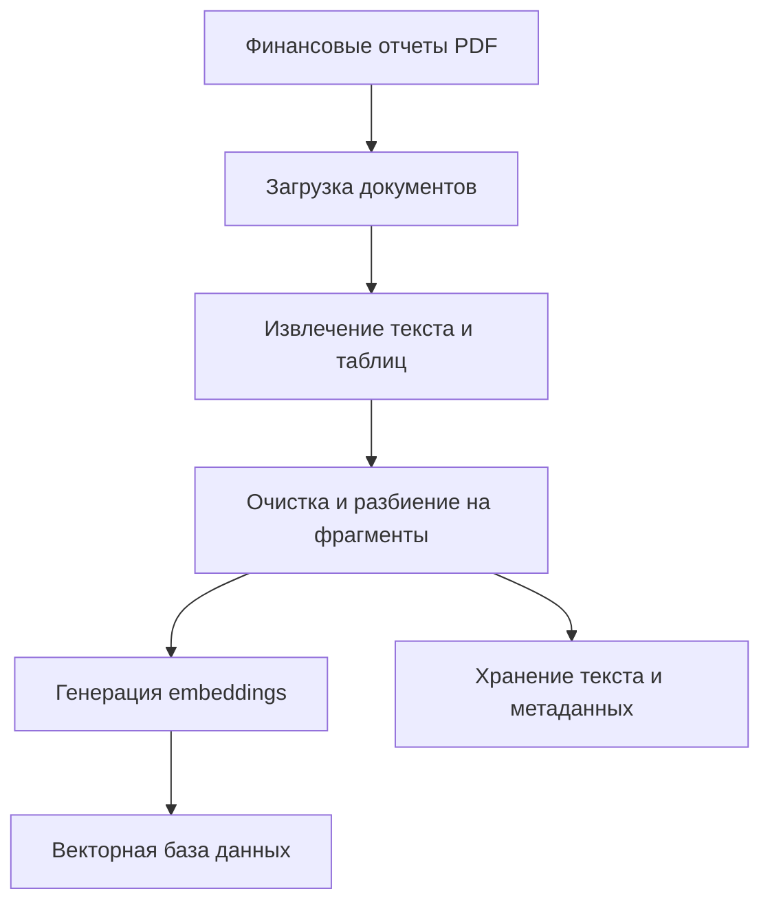
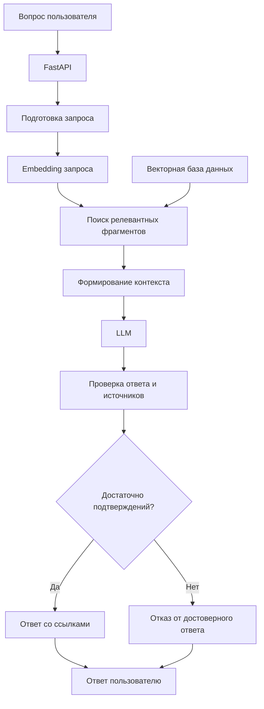

# FinReport AI - ML System Design Document

**Версия:** 0.1  
**Статус:** Draft  
**Этап:** Проектирование системы, HW1

## 1. Зачем идём в разработку продукта?

### 1.1. Бизнес-контекст

Финансовые аналитики, инвестиционные исследователи и специалисты по корпоративным финансам регулярно изучают финансовую отчетность публичных компаний.

Типовые задачи включают:

- Поиск финансовых показателей в годовых отчетах.
- Сравнение результатов компании за разные отчетные периоды.
- Анализ изменений выручки, прибыли, рентабельности и долговой нагрузки.
- Поиск объяснений финансовых результатов в комментариях руководства.
- Подготовку аналитических справок на основе первоисточников.

Корпоративная отчетность может включать сотни страниц текста, таблиц и примечаний. Ручная обработка требует значительных временных затрат.

### 1.2. Бизнес-проблема

Текущий процесс предполагает самостоятельный поиск документов, чтение отчетности, извлечение финансовых показателей и формирование выводов.

Основные проблемы:

1. Значительное время на поиск необходимой информации.
2. Сложность сопоставления показателей за разные периоды.
3. Риск ошибок при ручном переносе числовых данных.
4. Отсутствие единого интерфейса для работы с несколькими документами.
5. Необходимость проверки каждого вывода по первоисточнику.

### 1.3. Цель проекта

Разработать ML-систему, позволяющую получать проверяемые ответы на финансовые вопросы на естественном языке с использованием корпоративной отчетности.

Основная бизнес-гипотеза:

**Применение RAG позволит сократить время выполнения типовых аналитических задач без существенного ухудшения точности получаемой информации.**

### 1.4. Ожидаемый бизнес-эффект

Основной показатель эффективности - сокращение времени выполнения аналитической задачи относительно ручного процесса.

Дополнительные показатели:

- Доля корректно выполненных аналитических задач.
- Доля ответов, подтвержденных первоисточниками.
- Стоимость одного успешно выполненного запроса.
- Частота ошибок при извлечении финансовых показателей.

Экономический эффект предполагается оценивать по результатам пилотного исследования с участием пользователей.

## 2. Бизнес-требования и ограничения

### 2.1. Заинтересованные стороны

**Основные пользователи:**

- Финансовые аналитики.
- Инвестиционные исследователи.
- Специалисты по корпоративным финансам.

**Заинтересованные стороны проекта:**

- Product Owner - отвечает за бизнес-результат.
- ML Engineer - отвечает за ML-компоненты.
- Backend Engineer - отвечает за API и интеграции.
- Финансовый эксперт - оценивает корректность ответов.

Роли приведены как предполагаемая организационная модель, а не фактический состав команды.

### 2.2. Функциональные требования

**FR-1. Загрузка документов**

Система должна поддерживать загрузку финансовых отчетов в формате PDF.

**FR-2. Обработка документов**

Система должна извлекать текст, таблицы и метаданные документов.

**FR-3. Индексация**

Система должна создавать поисковый индекс по обработанным документам.

**FR-4. Поиск информации**

Система должна поддерживать поиск релевантных фрагментов отчетности по запросу пользователя.

**FR-5. Генерация ответов**

Система должна формировать ответы на естественном языке с использованием найденных фрагментов.

**FR-6. Проверяемость**

Ответ должен содержать ссылки на использованные документы и, при технической возможности, номера страниц.

**FR-7. Обработка недостатка информации**

При отсутствии достаточных данных система должна сообщать о невозможности сформировать достоверный ответ.

**FR-8. API**

Система должна предоставлять REST API для отправки вопросов и получения ответов.

### 2.3. Нефункциональные требования

Предварительные проектные ориентиры для MVP:

| Параметр | Требование |
|---|---|
| Время ответа | p95 не более 15 секунд |
| Доступность | Целевой уровень 99% |
| Обработка документов | Асинхронная |
| Воспроизводимость | Версионирование конфигураций и моделей |
| Наблюдаемость | Логирование ошибок, задержек и стоимости |
| Масштабирование | Возможность независимого масштабирования API и обработки документов |

Указанные показатели являются проектными гипотезами и должны быть уточнены после нагрузочного тестирования.

### 2.4. Ограничения

- На первом этапе используются открытые финансовые документы.
- Основной формат документов - PDF с извлекаемым текстом.
- Рукописные документы не поддерживаются.
- Финансовые рекомендации не формируются.
- Система не выполняет торговые операции.
- Ответы LLM не считаются достоверными без проверки источников.
- Бюджет и вычислительные ресурсы ограничены рамками учебного проекта.

## 3. Границы проекта

### 3.1. Входит в MVP

1. Загрузка ограниченного набора финансовых отчетов.
2. Извлечение текста и базовая обработка таблиц.
3. Разбиение документов на фрагменты.
4. Создание поискового индекса.
5. Семантический поиск.
6. Генерация ответов с помощью LLM.
7. Предоставление ссылок на источники.
8. REST API.
9. Базовая оценка качества поиска и ответов.
10. Логирование запросов и ошибок.

### 3.2. Не входит в MVP

- Прогнозирование котировок акций.
- Автоматизированная инвестиционная аналитика с рекомендациями.
- Поддержка всех возможных форматов отчетности.
- Полноценная обработка сканированных документов.
- Обучение собственной LLM с нуля.
- Автоматическая торговля.
- Интеграция с брокерскими системами.
- Гарантированная поддержка произвольных финансовых вычислений.

### 3.3. Возможные последующие итерации

- Гибридный поиск BM25 + embeddings.
- Reranking найденных документов.
- Структурированное извлечение финансовых показателей.
- Сравнение нескольких компаний.
- Поддержка отчетности на разных языках.
- Автоматическое обновление базы документов.
- Мониторинг качества ответов и деградации поиска.

## 4. Предпосылки решения

### 4.1. Почему используется ML?

Финансовые документы содержат большой объем неструктурированного текста.

Пользовательские запросы могут отличаться по формулировке от соответствующих фрагментов отчетности.

Поэтому исключительно точный поиск по ключевым словам может не находить релевантную информацию.

Предполагается, что семантический поиск позволит улучшить качество извлечения релевантных фрагментов, а LLM - сформировать удобный для пользователя ответ.

Данная гипотеза требует экспериментальной проверки.

### 4.2. Почему RAG?

RAG позволяет использовать внешнюю базу документов при формировании ответа без необходимости дообучения LLM на каждой новой версии отчетности.

Потенциальные преимущества:

- Использование актуализируемой базы документов.
- Возможность указывать источники информации.
- Независимое обновление документов и генеративной модели.
- Возможность сравнения разных моделей поиска.
- Снижение зависимости от знаний, полученных LLM во время предобучения.

При этом RAG не гарантирует фактическую корректность ответов. Необходимы отдельные механизмы оценки качества.

### 4.3. Альтернативные решения

**Альтернатива A - ручной анализ.**

Не требует ML-инфраструктуры, но предполагает значительные затраты рабочего времени.

**Альтернатива B - полнотекстовый поиск BM25.**

Позволяет находить фрагменты по ключевым словам без использования генеративных моделей.

**Альтернатива C - RAG.**

Объединяет поиск релевантных фрагментов и генерацию ответа на естественном языке.

Решение о целесообразности RAG принимается на основе сравнения качества, времени обработки и полной стоимости эксплуатации.

## 5. Постановка ML-задачи

### 5.1. Формализация

Пусть:

- D - множество финансовых документов.
- q - вопрос пользователя.
- R(q, D) - функция поиска релевантных фрагментов.
- C - набор найденных фрагментов.
- G(q, C) - функция генерации ответа.
- a - итоговый ответ.

Тогда:

C = R(q, D)

a = G(q, C)

Необходимо разработать систему, максимизирующую корректность и проверяемость ответов при соблюдении ограничений по задержке и стоимости.

### 5.2. Основные ML-подзадачи

**Задача 1 - Information Retrieval**

Поиск релевантных фрагментов финансовых документов.

Baseline: BM25.

Основной кандидат: dense retrieval на основе embeddings.

**Задача 2 - Reranking**

Повторное ранжирование найденных фрагментов для улучшения качества контекста.

Рассматривается как развитие базовой версии.

**Задача 3 - Answer Generation**

Формирование ответа на вопрос пользователя на основе найденных документов.

Используется предобученная LLM.

**Задача 4 - Answer Validation**

Проверка наличия подтверждающих источников и корректности извлеченных финансовых показателей.

### 5.3. Метрики качества

| Уровень | Метрика | Назначение |
|---|---|---|
| Retrieval | Recall@5 | Полнота поиска релевантных фрагментов |
| Retrieval | nDCG@5 | Качество ранжирования |
| Generation | Faithfulness | Соответствие ответа контексту |
| Generation | Answer Correctness | Фактическая корректность |
| Extraction | Exact Match / Numeric Accuracy | Точность извлечения показателей |
| System | p95 latency | Скорость ответа |
| Economics | Cost per Successful Task | Стоимость успешного выполнения задачи |

### 5.4. Критерии успеха

Предварительные целевые значения для пилота:

- Recall@5 не ниже 0.85.
- Не менее 90% ответов содержат корректные ссылки на источники.
- Сокращение медианного времени выполнения аналитической задачи не менее чем на 30% относительно ручного процесса.
- p95 задержки не более 15 секунд.

Эти значения являются гипотезами. Их достижимость необходимо проверить экспериментально.

## 6. Блок-схема решения

### 6.1. Обработка документов

### 6.2. Обработка пользовательского запроса

Схемы описывают целевую архитектуру. Компоненты проверки ответов и обработки таблиц требуют отдельной технической валидации.

## 7. Данные

### 7.1. Источники

Предполагаемый основной источник - открытая корпоративная отчетность из SEC EDGAR.

Сайт: https://www.sec.gov/edgar

Дополнительные источники - публичные годовые отчеты компаний.

### 7.2. Состав данных

Для каждого документа предполагается хранить:

- Идентификатор документа.
- Название компании.
- Отчетный период.
- Тип отчетности.
- Исходный файл.
- Извлеченный текст.
- Номера страниц.
- Текстовые фрагменты.
- Векторные представления.
- Метаданные источника.

### 7.3. Подготовка оценочного датасета

Планируется сформировать набор финансовых вопросов с эталонными ответами и указанием подтверждающих фрагментов документов.

Типы вопросов:

- Поиск конкретного финансового показателя.
- Сравнение показателей за разные периоды.
- Поиск причин изменения финансовых результатов.
- Вопросы, на которые в документах отсутствует ответ.

Оценочная выборка должна быть отделена от данных, используемых для настройки компонентов поиска и генерации.

## 8. План разработки

### Итерация 1 - System Design

- Формулировка бизнес-задачи.
- Определение требований и ограничений.
- Выбор архитектуры.
- Определение метрик.
- Подготовка репозитория и документации.

### Итерация 2 - Data Pipeline

- Получение финансовых документов.
- Извлечение текста.
- Подготовка и индексация данных.
- Формирование оценочного датасета.

### Итерация 3 - Baseline и RAG

- Реализация BM25 baseline.
- Реализация семантического поиска.
- Интеграция LLM.
- Сравнение качества решений.

### Итерация 4 - Production Design

- Реализация API.
- Контейнеризация.
- Мониторинг.
- Тестирование производительности.
- Анализ стоимости эксплуатации.

Конкретный объем итераций будет согласован с последующими заданиями курса.

## 9. Риски

| Риск | Последствие | Меры снижения |
|---|---|---|
| Ошибки извлечения PDF | Потеря финансовых данных | Проверка качества парсинга |
| Некорректная обработка таблиц | Ошибки в числовых ответах | Структурированное извлечение |
| Галлюцинации LLM | Недостоверные выводы | Проверка источников, отказ от ответа |
| Низкое качество поиска | Пропуск релевантных сведений | Сравнение BM25 и dense retrieval |
| Высокая стоимость LLM | Низкая экономическая эффективность | Контроль токенов, кеширование |
| Большая задержка | Ухудшение пользовательского опыта | Асинхронная обработка, оптимизация |
| Изменение структуры отчетов | Ошибки ingestion pipeline | Мониторинг качества обработки |

## 10. Экономическое обоснование

Основная единица анализа - успешно выполненная аналитическая задача.

Планируется учитывать:

- Стоимость разработки.
- Стоимость хранения и обработки документов.
- Стоимость embeddings.
- Стоимость LLM inference.
- Стоимость инфраструктуры.
- Затраты на проверку ответов человеком.
- Затраты на сопровождение системы.

Экономический эффект будет оцениваться относительно ручного анализа.

Сокращение рабочего времени само по себе не приравнивается к денежной экономии. Необходимо определить, какая часть высвобожденного времени приводит к снижению затрат или увеличению производительности.

Для сравнения вариантов решения будет использоваться стоимость одной корректно выполненной задачи, включая необходимые проверки.

## 11. Условия дальнейшего развития

Проект может перейти к следующей стадии при выполнении следующих условий:

1. Подтверждена доступность и пригодность данных.
2. Получено измеримое улучшение пользовательского процесса.
3. Качество ответов соответствует согласованным требованиям.
4. Стоимость эксплуатации не превышает ожидаемую ценность.
5. Критические риски имеют приемлемые способы контроля.

Если RAG не обеспечивает достаточного преимущества относительно полнотекстового поиска, архитектура должна быть пересмотрена.

## 12. Текущий статус

На момент первой итерации проект находится на стадии проектирования.

Бизнес-эффект, качество моделей, целевые показатели производительности и экономическая эффективность пока не подтверждены экспериментально.

Следующий этап - проверка доступности данных и реализация baseline.
